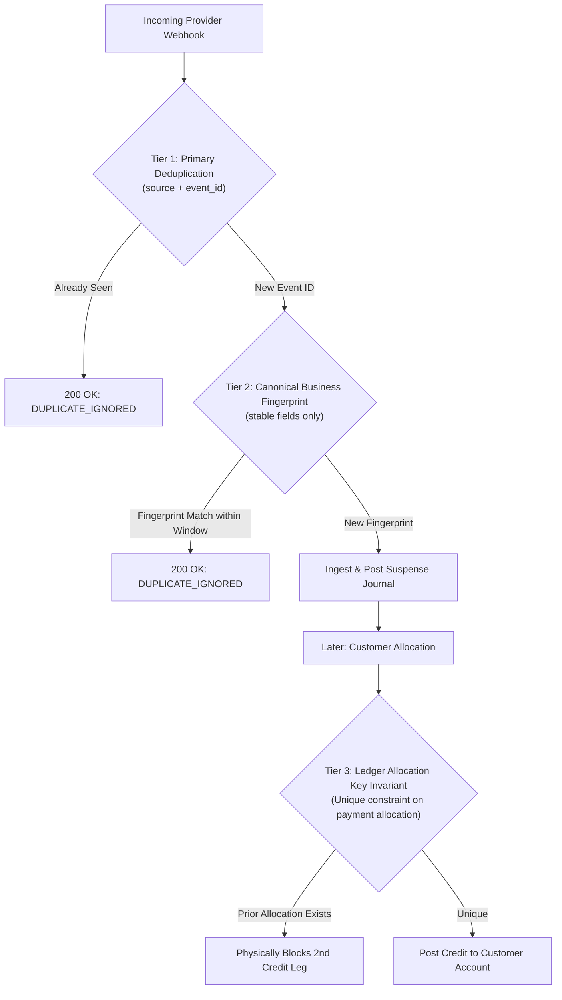
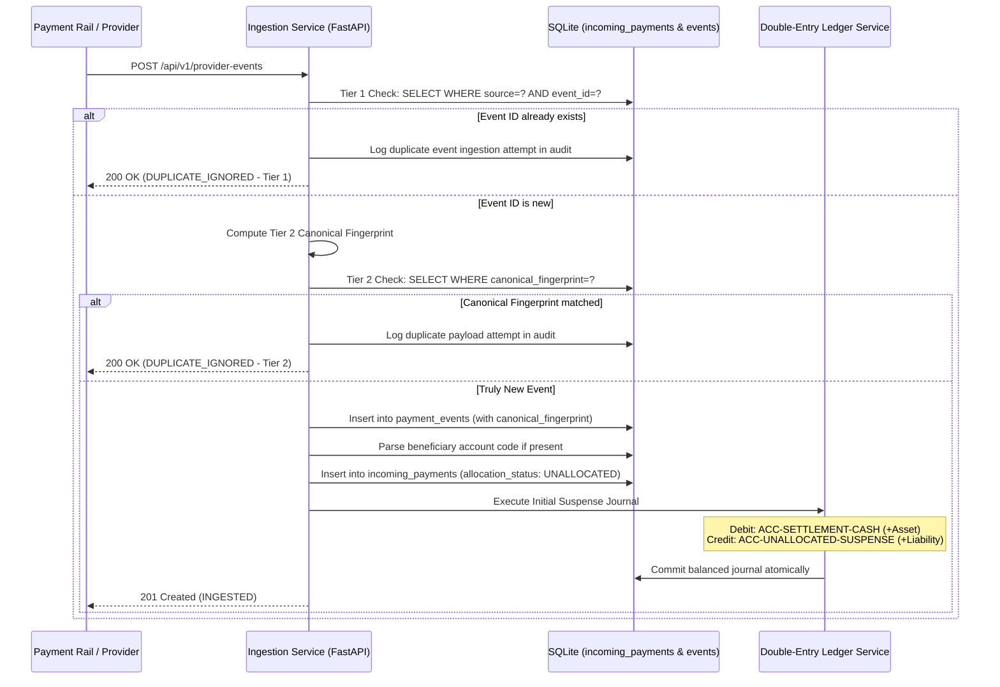

# Spec 02: Payment Ingestion & Synthetic Rail Simulator

## 1. Overview
This specification details how ResolveFlow AI ingests incoming payment rail events from authorized payment providers (e.g. Faster Payments, ClearBank, Modulr) and provides a synthetic payment rail simulator to generate controlled test transactions.

---

## 2. Multi-Tier Idempotency & Financial Protection Architecture
Relying solely on a raw payload SHA-256 hash is insufficient in production payment systems because legitimate duplicate deliveries often vary by transmission metadata (e.g. HTTP timestamps, attempt counters, gateway IDs), while two different payments could theoretically share simple payloads.

ResolveFlow enforces a **Three-Tier Defense-in-Depth Idempotency Architecture**:



### Tier 1: Primary Deduplication (Provider Identifier + Event ID)
- Composite uniqueness on `(source, event_id)` in the `payment_events` table (e.g. `("FASTER_PAYMENTS", "EVT-FP-2026-001")`).
- The payment gateway's stable event identifier is the primary key for ingress deduplication.

### Tier 2: Secondary Protection (Canonical Business Fingerprinting)
- Used when event IDs are volatile, retried across different gateway nodes, or during reconciliation batches.
- We construct a deterministic canonical fingerprint string strictly from **immutable financial fields**, deliberately omitting volatile metadata (e.g., webhook timestamps, retry counts, HTTP request headers):
  $$\text{canonical\_payload} = \text{source} \,\|\, \text{provider\_reference} \,\|\, \text{sender\_bank} \,\|\, \text{amount\_minor} \,\|\, \text{currency} \,\|\, \text{raw\_reference}$$
  $$\text{canonical\_fingerprint} = \text{SHA-256}(\text{canonical\_payload})$$
- If an event arrives with a matching fingerprint within the active ingestion window, it is flagged as a duplicate transmission.

### Tier 3: Financial Protection (Unique Allocation Key Invariant)
- **The Core Rule**: Receiving the same payment event multiple times must **NEVER** credit a customer twice.
- Enforced at the SQLite storage layer via an immutable uniqueness constraint on the customer allocation journal:
  $$\text{idempotency\_key} = \text{f"ALLOC-\{payment\_id\}"}$$
- Even if an event somehow bypassed Tier 1 and Tier 2 (e.g. through a simulated data anomaly or concurrent race condition), the database engine will reject any second allocation journal with a `UNIQUE constraint failed` error.

---

## 3. Ingestion Endpoint Specification

### `POST /api/v1/provider-events`
Receives and processes an incoming payment event from the payment rail.

#### Request Schema (`ProviderEventPayload`)
```json
{
  "event_id": "EVT-FP-2026-001",
  "source": "FASTER_PAYMENTS",
  "event_type": "FUNDS_SETTLED",
  "provider_reference": "FP-2026-X881",
  "sender_bank": "Monzo",
  "raw_reference": "MON-78291 ACC-LEN-001",
  "amount_minor": 50000,
  "currency": "GBP",
  "event_time": "2026-11-09T09:00:00Z"
}
```

#### Fields Description
- `event_id`: Unique identifier assigned by provider (string, unique per source).
- `source`: Rail name (`"FASTER_PAYMENTS"`, `"CLEARBANK"`, `"MODULR"`).
- `event_type`: Lifecycle event (`"FUNDS_SETTLED"`, `"STATUS_UPDATED"`, `"FUNDS_RETURNED"`).
- `provider_reference`: Rail transaction reference.
- `sender_bank`: Origin bank name.
- `raw_reference`: Unparsed reference text entered by sender.
- `amount_minor`: Amount in integer pence/cents (>= 0).
- `currency`: 3-letter currency code (`"GBP"`).
- `event_time`: UTC timestamp of rail execution.

#### Response Schemas
**Success (201 Created):**
```json
{
  "status": "INGESTED",
  "payment_id": "PAY-FP-2026-X881",
  "allocation_status": "UNALLOCATED",
  "canonical_fingerprint": "a94a8fe5ccb19ba61c4c0873d391e987982fbbd3",
  "journal_id": "JRN-RECEIPT-PAY-FP-2026-X881",
  "duplicate": false
}
```

**Idempotent Duplicate (200 OK):**
```json
{
  "status": "DUPLICATE_IGNORED",
  "payment_id": "PAY-FP-2026-X881",
  "allocation_status": "UNALLOCATED",
  "deduplication_tier": "TIER_1_EVENT_ID",
  "duplicate": true
}
```

---

## 4. Ingestion Workflow & State Transitions



---

## 5. Reference Parsing Logic
When a raw reference like `"MON-78291 ACC-LEN-001"` or `"LEN-001 Ben"` arrives:
1. Regex match against pattern `(ACC-LEN-\d{3}|LEN-\d{3})`.
2. If matched: Normalize to standardized `ACC-LEN-XXX` and store in `incoming_payments.beneficiary_account_id`.
3. If no account code is matched (e.g. `"MON-33112 BEN CHIDERA"`): Store `beneficiary_account_id = None`. The payment enters the unallocated pool as an ambiguous receipt.

---

## 6. Synthetic Payment Rail Simulator

To allow reproducible local testing without external bank dependencies, a simulator module provides helper functions:

```python
class PaymentRailSimulator:
    def emit_settled_payment(
        source: str = "FASTER_PAYMENTS",
        sender_bank: str = "Monzo",
        amount_minor: int = 50000,
        raw_reference: str = "MON-78291 ACC-LEN-001",
        provider_ref: str | None = None
    ) -> ProviderEventPayload:
        """Simulates an incoming wire clearing through Faster Payments."""
        ...
        
    def emit_delayed_payment(
        sender_bank: str,
        amount_minor: int,
        raw_reference: str,
        delay_seconds: int
    ) -> None:
        """Simulates Scenario S6 (Late Arrival)."""
        ...

    def replay_event(
        event_id: str,
        alter_timestamp: bool = True
    ) -> ProviderEventPayload:
        """Simulates Scenario S4 (Duplicate Webhook with metadata shift)."""
        ...
```
