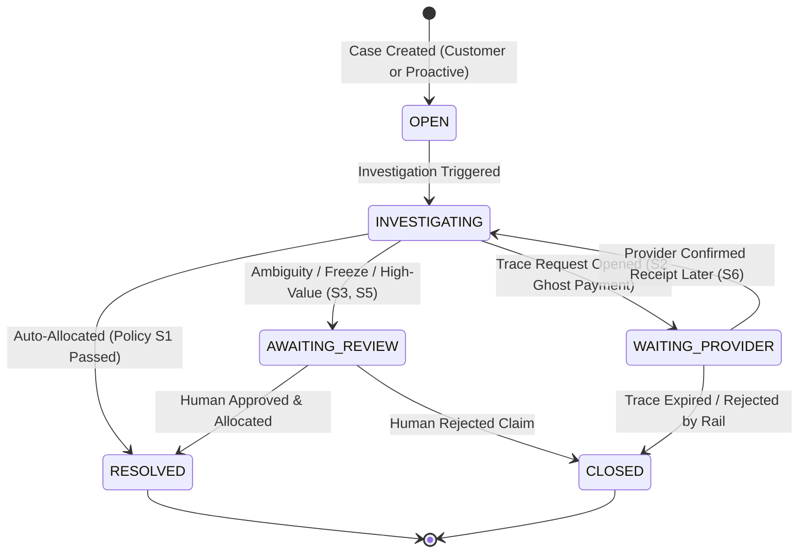

# Spec 03: Case Intake & Lifecycle Management

## 1. Overview
This specification defines how missing payment investigation cases are created, tracked, and updated. Cases originate either via **Entry A (Customer Complaint)** or **Entry B (Proactive Reconciliation Job)**.

---

## 2. Case State Machine



---

## 3. API Contract

### 3.1 Create Missing Payment Case (Customer Complaint)
`POST /api/v1/cases`

#### Request Payload
```json
{
  "customer_id": "CUST-101",
  "beneficiary_account_id": "ACC-LEN-001",
  "sender_bank": "Monzo",
  "payment_reference": "MON-78291",
  "amount_minor": 50000,
  "currency": "GBP",
  "expected_date": "2026-11-09"
}
```

#### Invariant Validations on Intake:
1. `beneficiary_account_id` must exist in `customers_accounts`.
2. `amount_minor` must be greater than zero.
3. If an identical active case (`state` in `['OPEN', 'INVESTIGATING', 'AWAITING_REVIEW']`) already exists for this `beneficiary_account_id` and `payment_reference`, return existing case (`409 Conflict` or existing case payload) to prevent duplicate complaint tickets.

#### Response (201 Created)
```json
{
  "case_id": "CASE-2026-001",
  "customer_id": "CUST-101",
  "beneficiary_account_id": "ACC-LEN-001",
  "reference": "MON-78291",
  "amount_minor": 50000,
  "currency": "GBP",
  "state": "OPEN",
  "created_at": "2026-11-09T10:00:00Z"
}
```

---

### 3.2 Get Case Details
`GET /api/v1/cases/{id}`

Returns the full case snapshot, including latest investigation findings, linked evidence references, and proposed actions.

#### Response (200 OK)
```json
{
  "case_id": "CASE-2026-001",
  "customer_id": "CUST-101",
  "beneficiary_account_id": "ACC-LEN-001",
  "reference": "MON-78291",
  "amount_minor": 50000,
  "currency": "GBP",
  "state": "AWAITING_REVIEW",
  "findings": {
    "provider_receipt_found": true,
    "payment_id": "PAY-S1-001",
    "receipt_amount_minor": 50000,
    "account_status": "ACTIVE",
    "candidate_accounts": ["ACC-LEN-001"],
    "suspense_cleared": false
  },
  "evidence_refs": ["PAY-S1-001", "EVT-S1-001"],
  "proposed_action": "AUTO_ALLOCATE",
  "created_at": "2026-11-09T10:00:00Z",
  "updated_at": "2026-11-09T10:01:15Z"
}
```

---

### 3.3 Trigger Proactive Reconciliation
`POST /api/v1/reconciliation/run`

Scans `incoming_payments` for records where:
- `allocation_status = 'UNALLOCATED'`
- `provider_status = 'SETTLED'`
- `received_at <= NOW - INTERVAL 15 MINUTES`
- No active case already linked to this `payment_id`.

For each unallocated payment found:
- Automatically creates an `investigation_case` with `customer_id = 'SYSTEM_PROACTIVE'`.
- Immediately runs the investigation pipeline to attempt automated resolution before the customer even contacts support.

#### Response (200 OK)
```json
{
  "scanned_unallocated_count": 5,
  "cases_created": 2,
  "auto_resolved": 1,
  "routed_to_review": 1
}
```

---

### 3.4 Get Payment Lifecycle Trace
`GET /api/v1/payments/{id}/trace`

Returns the complete forensic timeline of a payment, including clearing provider messages, ledger journals, and case associations.

#### Response (200 OK)
```json
{
  "payment_id": "PAY-S1-001",
  "provider_reference": "FP-2026-X881",
  "sender_bank": "Monzo",
  "amount_minor": 50000,
  "currency": "GBP",
  "current_status": "SETTLED",
  "allocation_status": "ALLOCATED",
  "timeline": [
    {
      "time": "2026-11-09T09:00:00Z",
      "stage": "RECEIPT",
      "description": "Faster Payments wire settled into settlement account"
    },
    {
      "time": "2026-11-09T09:00:01Z",
      "stage": "SUSPENSE_BOOKED",
      "description": "Posted to ACC-UNALLOCATED-SUSPENSE under Journal JRN-S1-001"
    },
    {
      "time": "2026-11-09T10:00:00Z",
      "stage": "COMPLAINT_OPENED",
      "description": "Case CASE-2026-001 opened by CUST-101"
    },
    {
      "time": "2026-11-09T10:01:30Z",
      "stage": "ALLOCATED",
      "description": "Reclassified from Suspense to ACC-LEN-001 under Journal JRN-S1-002"
    }
  ]
}
```

