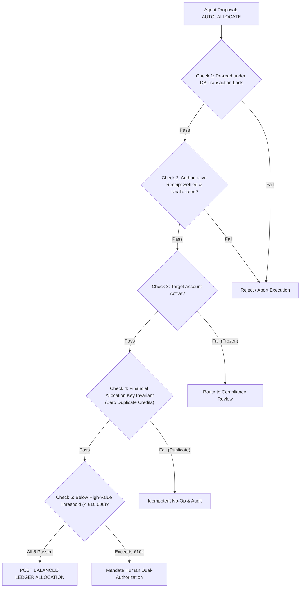

# Spec 05: Deterministic Policy Engine & Financial Execution

## 1. Overview
In financial engineering, the AI/LLM layer is an **investigator and advisor**, never the final authority. The **Deterministic Policy Engine** and **Ledger Posting Service** own all execution authority. No funds are credited, moved, or altered without passing through this deterministic gate.

---

## 2. The 5 Non-Negotiable Policy Invariants



### Invariant 1: Fresh Read Under Database Lock
Agent proposals can take seconds to generate. Before executing:
- Open an exclusive database transaction.
- Re-read `incoming_payments` and `customers_accounts` fresh from SQLite.
- Ensure payment status has not changed (e.g. concurrent return or recall).

### Invariant 2: Authoritative Receipt Must Be Settled & Unallocated
- `incoming_payments.provider_status` MUST be `SETTLED`.
- `incoming_payments.allocation_status` MUST be `UNALLOCATED`.
- Funds MUST be verified to exist in `ACC-UNALLOCATED-SUSPENSE`.

### Invariant 3: Beneficiary Account Must Be Active
- Target account status MUST be `ACTIVE`.
- If status is `FROZEN` or `CLOSED`, auto-allocation is strictly prohibited. Case is held and escalated.

### Invariant 4: Zero Duplicate Credits (Financial Allocation Key Invariant)
The most critical requirement in the system: **receiving the same payment event multiple times must never credit a customer twice.**
This is enforced at two defense layers:
1. **Application Layer Check**: Query `ledger_entries` for any existing credit legs with `source_payment_id == payment_id`. If found, abort immediately.
2. **Database Storage Layer Invariant**: The allocation journal has a deterministic idempotency key:
   $$\text{idempotency\_key} = \text{f"ALLOC-\{payment\_id\}"}$$
   Backed by a `UNIQUE` constraint on `journal_entries.idempotency_key`. Even if two parallel processes race to allocate the exact same payment simultaneously, SQLite's ACID guarantees that only one transaction succeeds, and the other fails with a `UNIQUE constraint` rejection.

### Invariant 5: Value Threshold Guardrail
- Any transaction where `amount_minor >= 1_000_000` (£10,000.00 / 1 million pence) cannot be auto-allocated.
- It MUST be routed for human dual-authorization, regardless of exact reference matches.

---

## 3. Financial Posting Execution Service

When all 5 policy checks pass, the execution service posts a balanced journal:

### Reclassification Journal
```text
Journal ID: JRN-ALLOC-{payment_id}
Idempotency Key: ALLOC-{payment_id}  <-- Unique Allocation Key
Reference: {case_id}
Description: "Reclassified unallocated receipt to customer account"
```

| Leg | Account | Debit (Minor) | Credit (Minor) | Purpose |
| :--- | :--- | :--- | :--- | :--- |
| **Leg 1** | `ACC-UNALLOCATED-SUSPENSE` | `50000` (£500) | `0` | Clears the suspense holding liability |
| **Leg 2** | `ACC-LEN-001` (Customer) | `0` | `50000` (£500) | Credits the customer deposit liability |

$$\sum \text{Debits} - \sum \text{Credits} = 50000 - 50000 = 0$$

### Post-Condition Updates (Atomic in same DB transaction):
1. Update `incoming_payments.allocation_status = 'ALLOCATED'`.
2. Update `investigation_cases.state = 'RESOLVED'`.
3. Append `audit_events` row:
   ```json
   {
     "actor": "DeterministicPolicyEngine",
     "action": "AUTO_ALLOCATE_SUCCESS",
     "policy_version": "v1.0.0",
     "before_state": "UNALLOCATED",
     "after_state": "ALLOCATED",
     "details": "Journal JRN-ALLOC-PAY-S1-001 posted. Customer ACC-LEN-001 credited."
   }
   ```
