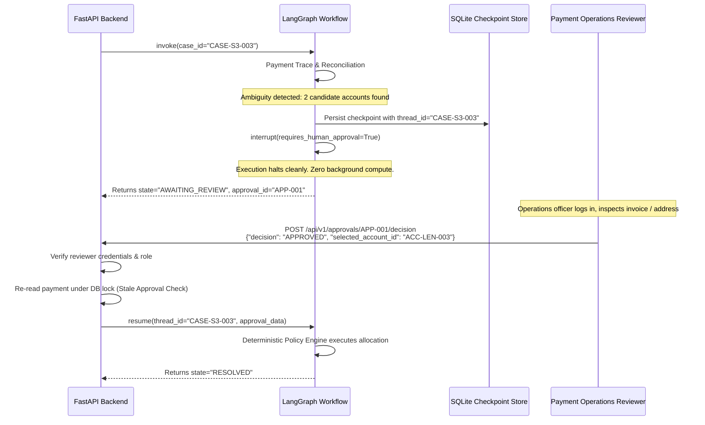

# Spec 06: Human Review & Approval Workflow

## 1. Overview
When deterministic rules encounter ambiguity (e.g. multiple matching customer names), account freezes, or high-value thresholds, ResolveFlow halts automated processing and triggers a **Human-in-the-Loop review**. This specification defines how LangGraph pauses, how approval tickets are managed, and how execution resumes safely.

---

## 2. Trigger Conditions for Human Review
Automated allocation is strictly aborted and routed to human review under any of the following triggers:
1. **Ambiguous Beneficiary (Scenario S3)**: Wire reference matches multiple customer accounts (e.g. "Ben Chidera" matches Personal and Business accounts).
2. **Account Restriction (Scenario S5)**: Beneficiary account has status `FROZEN` or `CLOSED`.
3. **High-Value Threshold**: Amount $\ge £10,000.00$ (`1_000_000` pence).
4. **Conflicting Payment Status**: Provider reports `SETTLED`, but internal ledger indicates payment was previously recalled or returned.

---

## 3. LangGraph Interrupt & State Suspension



---

## 4. API Contract: Approval Decision

### `POST /api/v1/approvals/{id}/decision`

#### Request Payload
```json
{
  "reviewer_id": "ops_sarah",
  "reviewer_role": "PAYMENT_OPERATIONS",
  "decision": "APPROVED",
  "selected_account_id": "ACC-LEN-003",
  "reason": "Verified residential address against Monzo sort code confirmation sheet."
}
```

#### Fields Description
- `reviewer_id`: Operator identifier (string, required).
- `reviewer_role`: Must be `PAYMENT_OPERATIONS`, `COMPLIANCE_OFFICER`, or `ADMIN`.
- `decision`: `"APPROVED"` or `"REJECTED"`.
- `selected_account_id`: The disambiguated customer account ID (required if approving an ambiguous case).
- `reason`: Mandatory audit explanation for the decision.

#### Invariant Checks Before Resuming Execution:
1. **Role Verification**: Reviewer must possess authorized role permissions.
2. **Stale Approval Protection**: Re-read the payment from SQLite under an exclusive transaction.
   - If payment was already allocated while awaiting review $\rightarrow$ REJECT approval with `409 Conflict`.
   - If payment was returned or recalled on the rail $\rightarrow$ REJECT approval with `400 Bad Request`.
3. **Target Account Verification**: Ensure `selected_account_id` is currently `ACTIVE`.

#### Response (200 OK)
```json
{
  "approval_id": "APP-001",
  "case_id": "CASE-S3-003",
  "decision": "APPROVED",
  "reviewer_id": "ops_sarah",
  "execution_status": "EXECUTED",
  "journal_id": "JRN-ALLOC-PAY-S3-003",
  "decided_at": "2026-11-09T14:30:00Z"
}
```

---

## 5. Rejection Flow
If the operator selects `decision = "REJECTED"`:
1. Update `approval_requests.decision = 'REJECTED'`.
2. Update `investigation_cases.state = 'CLOSED'`.
3. Funds remain locked in `ACC-UNALLOCATED-SUSPENSE`.
4. Append `audit_events` row documenting rejection and operator rationale.
5. No customer ledger credit is posted.

